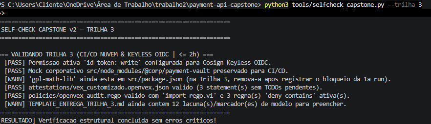
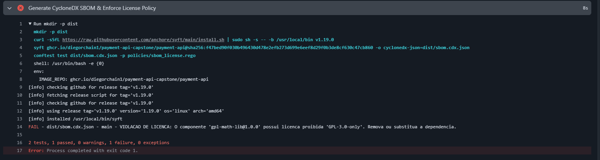

# Relatório de Evidências Cloud-Native — Projeto Final Capstone (Trilha 3)

**Nome do Aluno(a):** Diego Reis Chain  
**Turma:** Supply Chain Security (Turma 1746)  
**Trilha Escolhida:** Trilha 3 — Engenharia de Esteira em Nuvem & Keyless OIDC *(Tempo-alvo: ~95 min | Teto: 2h)*  
**Data:** 23/11/2026

- **Modalidade de Entrega:**
  - `[x] Trilha Única` *(primeira trilha entregue — responder também ao **Bloco Express** no final)*
  - `[-] Modo Incremental` *(já entreguei trilha anterior — **Bloco Express dispensado**; reutilizando `vex_customizado.openvex.json` e `openvex_audit.rego`)*

---

## 1. Links Oficiais da Entrega — *Aula 08* (`1,5 pts`)
- **Repositório Público no GitHub:** `https://github.com/diegorchain1/payment-api-capstone`
- **Run Bloqueada pelo Conftest (`FAIL` intencional da `GPL-3.0`):** `https://github.com/diegorchain1/payment-api-capstone/actions/runs/45235022330`


- **Run Verde Final (Após Remediação):** `https://github.com/diegorchain1/payment-api-capstone/actions/runs/45235819743`
- **Pacote Público no GHCR:** `ghcr.io/diegorchain1/payment-api-capstone/payment-api@sha256:c316b129e54cbda820c3e18281b8542cf4ecb55734706d945520ab5207158f54`
- **Registro Público no Rekor (`search.sigstore.dev`):** 4055643604

---

## 2. Hardening da Esteira, Rego v1 & Ciclo Red → Green — *Aulas 02, 03, 05 & 07* (`3,5 pts`)
- **Correções aplicadas antes do 1º push:**
  - `[x] TODO 1 resolvido: id-token: write habilitado em golden_pipeline_capstone.yml`
  - `[x] TODO 2 resolvido: actions/setup-node fixado por SHA-1 de 40 caracteres`
  - `[x] policies/openvex_audit.rego e attestations/vex_customizado.openvex.json sem TODOs pendentes`


- **Log do bloqueio inicial da `gpl-math-lib` pelo Conftest na run vermelha:**
  ``` text
  Run mkdir -p dist
  mkdir -p dist
  curl -sSfL https://raw.githubusercontent.com/anchore/syft/main/install.sh | sudo sh -s -- -b /usr/local/bin v1.19.0
  syft ghcr.io/diegorchain1/payment-api-capstone/payment-api@sha256:f47bed90f030b496430d478e2efb273d699e6eef8d29f0b3de8cf630c47cb860 -o cyclonedx-json=dist/sbom.cdx.json
  conftest test dist/sbom.cdx.json -p policies/sbom_license.rego
  shell: /usr/bin/bash -e {0}
  env:
    IMAGE_REPO: ghcr.io/diegorchain1/payment-api-capstone/payment-api
  [info] checking github for release tag='v1.19.0' 
  [info] fetching release script for tag='v1.19.0' 
  [info] checking github for release tag='v1.19.0' 
  [info] using release tag='v1.19.0' version='1.19.0' os='linux' arch='amd64' 
  [info] installed /usr/local/bin/syft 
  FAIL - dist/sbom.cdx.json - main - VIOLACAO DE LICENCA: O componente 'gpl-math-lib@1.0.0' possui licenca proibida 'GPL-3.0-only'. Remova ou substitua a dependencia.

  2 tests, 1 passed, 0 warnings, 1 failure, 0 exceptions
  Error: Process completed with exit code 1.
 
 

- **Commit da remediação (remoção de `gpl-math-lib`):** `b843ac1
`

---

## 3. Verificação Pública Keyless (Fulcio + Rekor) & Atestação OpenVEX — *Aulas 04 & 06* (`3,5 pts`)

- **Comando público executado (via GitHub Codespaces, CLI local ou container):**

  ```bash
  /tmp/cosign verify \
    --certificate-identity="https://github.com/diegorchain1/payment-api-capstone/.github/workflows/golden_pipeline_capstone.yml@refs/heads/main" \
    --certificate-oidc-issuer="https://token.actions.githubusercontent.com" \
    ghcr.io/diegorchain1/payment-api-capstone/payment-api@sha256:c316b129e54cbda820c3e18281b8542cf4ecb55734706d945520ab5207158f54


- Saída real do cosign verify e cosign verify-attestation --type openvex:
```
1. Verificação da assinatura Keyless com Fulcio e Rekor (cosign verify):
Verification for ghcr.io/diegorchain1/payment-api-capstone/payment-api@sha256:c316b129e54cbda820c3e18281b8542cf4ecb55734706d945520ab5207158f54 --
The following checks were performed on each of these signatures:
  - The cosign claims were validated
  - Existence of the claims in the transparency log was verified offline
  - The code-signing certificate was verified using trusted certificate authority certificates


Metadados da assinatura verificada:
docker-reference: ghcr.io/diegorchain1/payment-api-capstone/payment-api
docker-manifest-digest: sha256:c316b129e54cbda820c3e18281b8542cf4ecb55734706d945520ab5207158f54
type: cosign container image signature

Issuer: https://token.actions.githubusercontent.com
Subject: https://github.com/diegorchain1/payment-api-capstone/.github/workflows/golden_pipeline_capstone.yml@refs/heads/main

GitHub Workflow Name: Golden Pipeline Capstone - Esteira DevSecOps Blindada (SLSA L2 / Cosign Keyless)
GitHub Workflow Repository: diegorchain1/payment-api-capstone
GitHub Workflow Ref: refs/heads/main
GitHub Workflow SHA: b843ac19b1f52ae5f1f3b275f2552ec24c5d6ef8
GitHub Workflow Trigger: push
```

- Comando de verificação e decodificação da atestação OpenVEX:
```
/tmp/cosign verify-attestation \
  --type openvex \
  --certificate-identity="https://github.com/diegorchain1/payment-api-capstone/.github/workflows/golden_pipeline_capstone.yml@refs/heads/main" \
  --certificate-oidc-issuer="https://token.actions.githubusercontent.com" \
  ghcr.io/diegorchain1/payment-api-capstone/payment-api@sha256:c316b129e54cbda820c3e18281b8542cf4ecb55734706d945520ab5207158f54 \
  | jq '.payload | @base64d | fromjson'


Saída real obtida — payload OpenVEX decodificado:
{
  "_type": "https://in-toto.io/Statement/v0.1",
  "predicateType": "https://openvex.dev/ns",
  "subject": [
    {
      "name": "ghcr.io/diegorchain1/payment-api-capstone/payment-api",
      "digest": {
        "sha256": "c316b129e54cbda820c3e18281b8542cf4ecb55734706d945520ab5207158f54"
      }
    }
  ],
  "predicate": {
    "@context": "https://openvex.dev/ns/v0.2.0",
    "@id": "https://empresa.corp.internal/vex/payment-api/2026-11-18",
    "author": "SecOps & Supply Chain Defense Committee <secops@empresa.corp.internal>",
    "statements": [
      {
        "impact_statement": "A funcao qs vulneravel nao e invocada pelas rotas HTTP da aplicacao payment-api. O parser customizado de JSON isola completamente os parametros.",
        "justification": "code_not_reachable",
        "products": [
          {
            "@id": "pkg:npm/express@4.18.2"
          }
        ],
        "status": "not_affected",
        "vulnerability": {
          "description": "Vulnerabilidade de Prototype Pollution na biblioteca qs/express",
          "name": "CVE-2022-24999"
        }
      },
      {
        "impact_statement": "A aplicacao consome exclusivamente metodos de colecao (lodash.get, lodash.merge) sem manipulacao de strings por templates.",
        "justification": "vulnerable_code_cannot_be_controlled_by_adversary",
        "products": [
          {
            "@id": "pkg:npm/lodash@4.17.20"
          }
        ],
        "status": "not_affected",
        "vulnerability": {
          "description": "ReDoS em lodash.template",
          "name": "CVE-2020-28500"
        }
      },
      {
        "impact_statement": "A payment-api nao utiliza a funcao res.redirect() em seus endpoints ou fluxos de processamento. Portanto, o codigo vulneravel associado ao redirecionamento de URLs nao confiaveis nao faz parte do caminho de execucao do microsservico, nao permitindo a exploracao desta vulnerabilidade na aplicacao. ",
        "justification": "vulnerable_code_not_in_execute_path",
        "products": [
          {
            "@id": "pkg:npm/express@4.18.2"
          }
        ],
        "status": "not_affected",
        "vulnerability": {
          "description": "Open Redirect em versoes anteriores do Express.js ao passar URLs nao confiaveis em res.redirect()",
          "name": "CVE-2024-29041"
        }
      }
    ],
    "timestamp": "2026-11-18T12:00:00Z",
    "tooling": "OpenVEX v0.2.0 / Cosign Attest v2.4",
    "version": 1
  }
}
```
## 4. Artifacts & Self-Check — *Aula 08* (`0,5 pt`)
- **Artifacts baixados da aba Summary da run verde (`supply-chain-evidence-bundle`):**
  - `[x] dist/sbom.cdx.json`
  - `[x] dist/dossie_conformidade.json`
  - `[x] attestations/vex_customizado.openvex.json`
- **Saída do `python3 tools/selfcheck_capstone.py --trilha 3`:**
  ```text
  [Cole aqui o resultado do selfcheck --trilha 3]
  ```

---

## 5. Bloco Express Conceitual — *Aulas 01 & 02* (`1,0 pt`)
*(Dispensado automaticamente caso você marque a opção **Modo Incremental** no cabeçalho acima!)*

1. **SLSA v1.0 / NIST SSDF:** Por que o build executado no GitHub Actions com `id-token: write` e registro no Rekor atende a garantias superiores às de um build manual local? 
```
O build feito pelo GitHub Actions é mais confiável porque acontece em um ambiente controlado e automatizado. A permissão id-token: write permite que o GitHub Actions obtenha uma identidade temporária para assinar a imagem com Cosign, sem precisar armazenar chaves privadas. O registro no Rekor permite consultar publicamente a assinatura e verificar sua origem. Assim, é possível comprovar de onde veio a imagem e se ela foi assinada pelo fluxo esperado, oferecendo mais segurança do que um build manual local.
``` 
2. **Proteção contra Dependency Confusion:** Qual a função do arquivo `src/.npmrc` e da flag `npm install --ignore-scripts` executada na esteira? 
```
O arquivo src/.npmrc define de onde o npm deve buscar os pacotes, ajudando a evitar que dependências internas sejam substituídas por pacotes maliciosos publicados em repositórios públicos. Já a flag npm install --ignore-scripts impede a execução automática de scripts dos pacotes durante a instalação, reduzindo o risco de que um pacote malicioso execute comandos na esteira.
```
